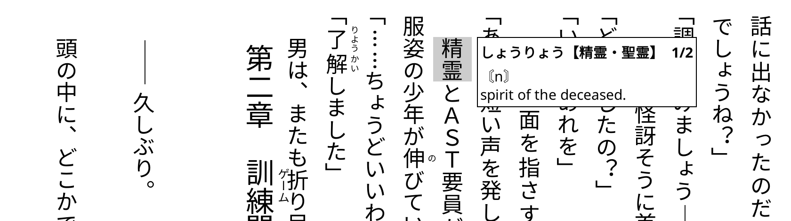

# phakos-mini-dict

A compact, fast dictionary popup for **KOReader**.

Instead of opening KOReader's large dictionary window, the definition appears in a small box next to the selected word. It shrinks to fit the text and is especially pleasant on e-ink, where full-screen dictionary refreshes are slow.

Originally developed for **phakOS** on a Kobo Libra H2O, but it uses only stock KOReader APIs and works as a normal KOReader plugin.

## Features

- Compact popup placed right of the word, else left, else above/below.
- Bold headword with a `1/2` result counter.
- HTML definitions converted to plain text.
- JMdict/StarDict repeated-headword line removed.
- Tap inside: next result.
- Hold inside: open the full stock dictionary window.
- Tap/hold/swipe outside or Back: close.
- Adjustable font size, maximum width, and maximum height.
- Falls back to the stock window if anything fails.
- Can be disabled with `phakos_mini_dict = false`.

## Install (manual)

1. Close KOReader.
2. Copy the `phakos-mini-dict.koplugin` directory into your KOReader `plugins` directory:

   ```text
   koreader/plugins/phakos-mini-dict.koplugin/
   ```

   Common locations:

   ```text
   .adds/koreader/plugins/    # Kobo
   koreader/plugins/          # Kindle
   ```

3. Restart KOReader.
4. Open **Tools → Plugin management** and make sure **Minimal dictionary popup** is enabled.

No patch or backend changes are required.

### Alternative: user patch

If you prefer KOReader's classic user-patch form, copy:

```text
patches/2-phakos-mini-dict.lua
```

into:

```text
koreader/patches/
```

Use either the plugin or the patch, not both. Installing both is harmless because of a guard, but unnecessary.

## Usage

Select a word as usual and open the dictionary. The compact popup appears next to the word.

- **Tap inside** → next dictionary result
- **Hold inside** → full stock dictionary window
- **Tap/hold/swipe outside or Back** → close

## Optional settings

Add these to KOReader's `settings.reader.lua`:

```lua
["phakos_mini_dict"] = true,
["phakos_mini_dict_font_size"] = 14,
["phakos_mini_dict_max_width"] = 0.45,   -- fraction of screen width
["phakos_mini_dict_max_height"] = 0.25,  -- fraction of screen height
```

## Uninstall

Remove the plugin directory:

```text
koreader/plugins/phakos-mini-dict.koplugin/
```

and restart KOReader. If you used the patch form, remove:

```text
koreader/patches/2-phakos-mini-dict.lua
```

## Compatibility

- Requires at least one configured KOReader dictionary, as usual.
- Works with or without the phakOS custom framebuffer backend. On stock KOReader it simply uses KOReader's normal partial refresh requests.
- Tested with KOReader `v2026.10.1` (koreader-tategumi fork) on a Kobo Libra H2O running phakOS.
- Version: **1.0.0**

## Credits

Made for [phakOS](https://github.com/torytyler) on the Kobo Libra H2O.
